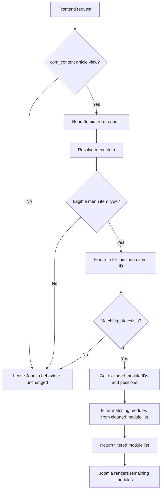

# Modules Nowhere

A Joomla 6 system plugin that prevents selected modules from appearing on individual article pages, depending on the menu item through which the article was accessed.

The plugin is intended to provide the functionality described in [Modules Nowhere](https://brian.teeman.net/joomla/896-modules-nowhere) without requiring template modifications.

## Status

The repository contains the initial project specification and the Joomla 6 system plugin skeleton. The filtering logic and administrator configuration have not yet been implemented.

## Requirements and behaviour

- Joomla 6 only.
- A system plugin operating on the frontend.
- Apply exclusions only to individual Joomla articles: `option=com_content` and `view=article`.
- Apply rules only when the article was accessed through an eligible menu item:
  - Category Blog (`blog_category`).
  - Category List (`category_list`).
- Identify the applicable rule by the menu item ID (`Itemid`) in the article request.
- Do not infer rules from the article's category or from parent menu items.
- Allow one rule per menu item.
- Each rule can select individual modules to exclude and module positions to exclude. Either or both selections may be empty.
- Excluding a module position excludes all modules assigned to that position.
- If there is no rule for the menu item, leave Joomla's normal module list and rendering behaviour unchanged.
- Do not affect category blog pages, category list pages, other component views, or articles reached through other menu item types.

### Example

Suppose the site has two Category Blog menu items:

| Menu item | Itemid | Modules excluded |
|---|---:|---|
| Blog – Joomla | 102 | ABC |
| Blog – News | 103 | DEF |

An article opened with `Itemid=102` uses the Joomla rule and excludes module ABC. An article opened with `Itemid=103` uses the News rule and excludes module DEF.

The same category may be linked from more than one menu item. Each menu item can have its own independent rule.

## Configuration

The administrator configuration will provide a repeatable list of rules. Each rule will contain:

1. A menu item selector, restricted to the supported Category Blog and Category List menu items.
2. A module selector allowing one or more individual modules to be excluded.
3. A module-position selector allowing one or more positions to be excluded.

A menu item must appear in no more than one rule. A rule may contain module exclusions, position exclusions, both, or neither.

## Processing workflow

The implementation uses Joomla's `onAfterCleanModuleList` system plugin event to adjust the module list before modules are rendered. Joomla dispatches an `AfterCleanModuleListEvent` after `ModuleHelper::cleanModuleList()` and before returning the module list. The event exposes `getModules()` and `updateModules(array $modules)`, allowing the plugin to replace the list without relying on legacy by-reference listener arguments.

## Important implementation notes

- The `Itemid` is the rule key. SEF URLs and non-SEF URLs must both be supported; the implementation should use Joomla's resolved request/menu data rather than parse a URL string.
- The plugin subscribes to `onAfterCleanModuleList` using Joomla's typed `AfterCleanModuleListEvent` and must call `updateModules()` with the filtered module array.
- The active menu item must be checked against the supported menu item types. An article's category alone must never select a rule.
- Filtering must happen before module rendering. Hiding rendered module HTML with CSS or output buffering is not acceptable.
- Module exclusions should use module instance IDs, not module titles or module extension names.
- Position exclusions should compare the module's assigned position with the configured positions.
- The plugin must fail safely: when the request, menu item, or rule does not qualify, it must not change the module list.

## Out of scope

- Joomla 5 compatibility.
- Excluding modules from category blog or category list pages themselves.
- Exclusions based solely on article category.
- Inheriting rules from parent menu items.
- Multiple rules for the same menu item.
- Template overrides or template-specific code.
